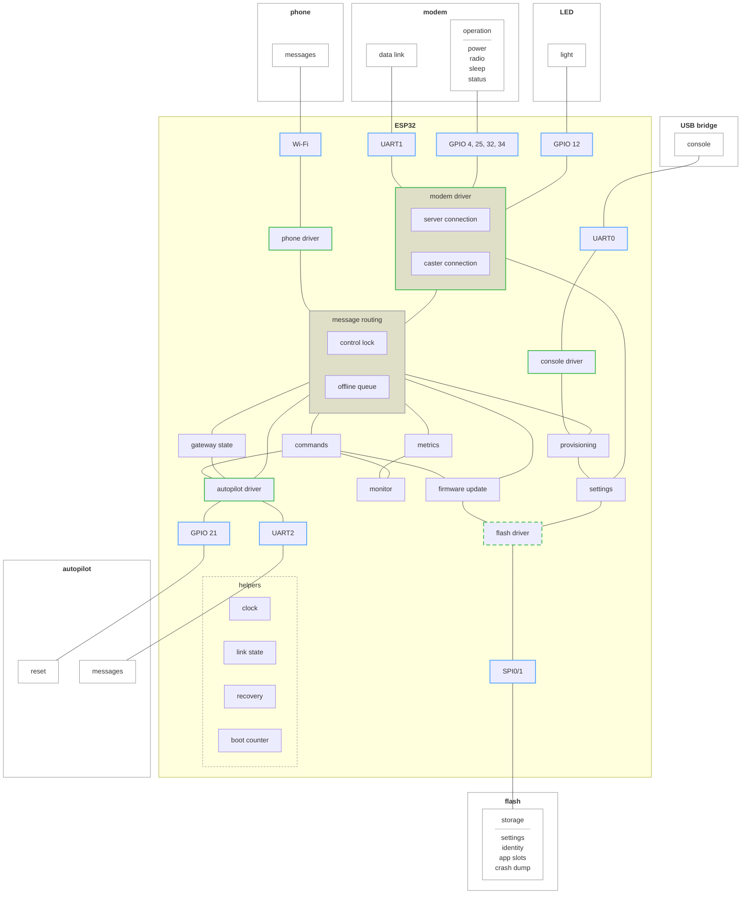

# Block diagram draft

Hand-drawn, not generated. From the hardware to the product function; a line is a connection. Blue: ways of communicating. Green: drivers; dashed: provided by the system, not ours. Inside a device: its aspects, grouped by the bus they use.

