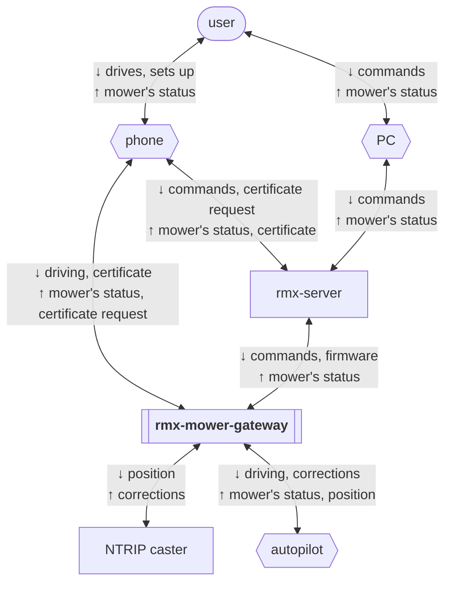
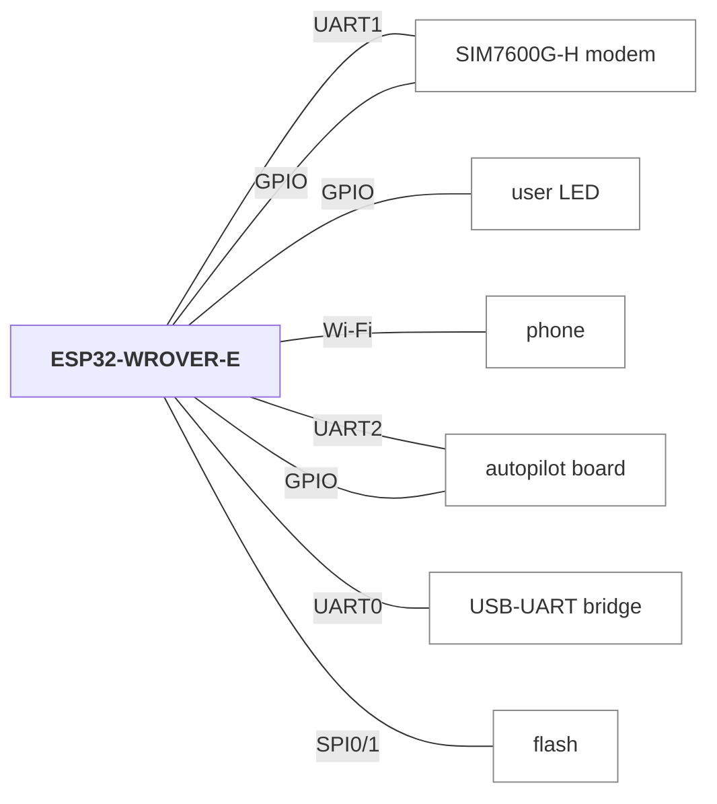
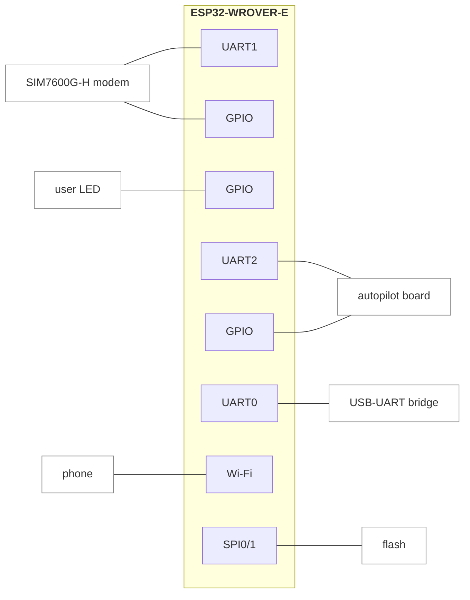
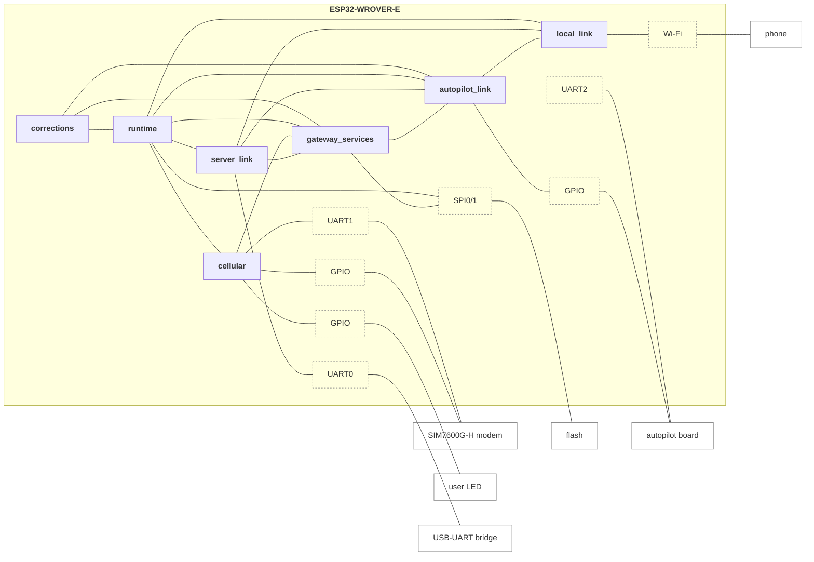
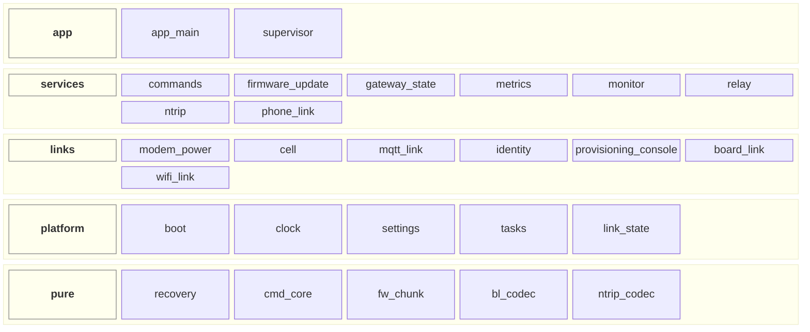

<!-- esp-architecture:diagrams begin: generated from .esp-architecture/manifest/architecture.yaml by generate_diagrams.py, do not edit -->

## Context

The device and the world around it.

## Block

### Level 1a: hardware

The processor and the devices outside it, one line per bus. LilyGo T-SIM7600 with the SIM7600G-H modem. The module has 16 MB flash and 8 MB PSRAM on its internal SPI0/1 bus.

### Level 1b: software

The same hardware, each bus a box inside the processor: the drivers to write.

### Level 2: subsystems

The subsystems inside the processor, each joined to the buses it drives and to the subsystems it is connected to.

| Subsystem | Components | Does |
|---|---|---|
| `runtime` | app_main, supervisor, boot, clock, settings, tasks, link_state, recovery | Start-up, recovery, settings, boot counter, clock, link state |
| `cellular` | modem_power, cell | LTE modem, PPP, signal, the user LED |
| `server_link` | mqtt_link, identity, provisioning_console | MQTT over TLS to the server, the device identity |
| `gateway_services` | commands, cmd_core, firmware_update, fw_chunk, gateway_state, metrics, monitor | Commands, firmware update, state, metrics, monitor |
| `autopilot_link` | board_link, bl_codec, relay | Board link to the autopilot and the relay of its MQTT traffic |
| `corrections` | ntrip, ntrip_codec | NTRIP corrections for the autopilot's RTK receiver |
| `local_link` | wifi_link, phone_link | A phone driving the mower and setting it up over Wi-Fi (planned) |

## Organigram

Who calls whom, from the top down (`depends_on`). Amber boxes: used by more than one component (settings, boot, identity, link_state, clock, cell, mqtt_link, commands, firmware_update, gateway_state, metrics, tasks, bl_codec, board_link); check contention (one caller at a time, locking, the slowest caller sets the pace).

```mermaid
flowchart TD
  n_app_main["app_main"]
  n_supervisor["supervisor"]
  n_boot["boot"]
  n_clock["clock"]
  n_settings["settings"]
  n_tasks["tasks"]
  n_link_state["link_state"]
  n_recovery["recovery"]
  n_modem_power["modem_power"]
  n_cell["cell"]
  n_mqtt_link["mqtt_link"]
  n_identity["identity"]
  n_provisioning_console["provisioning_console"]
  n_commands["commands"]
  n_cmd_core["cmd_core"]
  n_firmware_update["firmware_update"]
  n_fw_chunk["fw_chunk"]
  n_gateway_state["gateway_state"]
  n_metrics["metrics"]
  n_monitor["monitor"]
  n_board_link["board_link"]
  n_bl_codec["bl_codec"]
  n_relay["relay"]
  n_ntrip["ntrip"]
  n_ntrip_codec["ntrip_codec"]
  n_wifi_link["wifi_link"]
  n_phone_link["phone_link"]
  n_app_main --> n_supervisor
  n_app_main --> n_settings
  n_app_main --> n_boot
  n_app_main --> n_identity
  n_app_main --> n_provisioning_console
  n_app_main --> n_link_state
  n_app_main --> n_clock
  n_app_main --> n_cell
  n_app_main --> n_mqtt_link
  n_app_main --> n_commands
  n_app_main --> n_firmware_update
  n_app_main --> n_gateway_state
  n_app_main --> n_metrics
  n_app_main --> n_monitor
  n_app_main --> n_relay
  n_app_main --> n_ntrip
  n_app_main --> n_phone_link
  n_supervisor --> n_recovery
  n_supervisor --> n_tasks
  n_supervisor --> n_link_state
  n_supervisor --> n_boot
  n_supervisor --> n_cell
  n_supervisor --> n_mqtt_link
  n_supervisor --> n_firmware_update
  n_supervisor --> n_gateway_state
  n_supervisor --> n_metrics
  n_boot --> n_settings
  n_clock --> n_link_state
  n_cell --> n_modem_power
  n_cell --> n_link_state
  n_cell --> n_tasks
  n_mqtt_link --> n_identity
  n_mqtt_link --> n_link_state
  n_mqtt_link --> n_clock
  n_identity --> n_settings
  n_provisioning_console --> n_identity
  n_provisioning_console --> n_boot
  n_provisioning_console --> n_tasks
  n_commands --> n_cmd_core
  n_commands --> n_mqtt_link
  n_commands --> n_link_state
  n_commands --> n_clock
  n_commands --> n_boot
  n_commands --> n_tasks
  n_firmware_update --> n_fw_chunk
  n_firmware_update --> n_commands
  n_firmware_update --> n_mqtt_link
  n_firmware_update --> n_cell
  n_firmware_update --> n_settings
  n_firmware_update --> n_boot
  n_firmware_update --> n_link_state
  n_firmware_update --> n_gateway_state
  n_firmware_update --> n_tasks
  n_gateway_state --> n_mqtt_link
  n_gateway_state --> n_cell
  n_gateway_state --> n_boot
  n_gateway_state --> n_clock
  n_metrics --> n_mqtt_link
  n_metrics --> n_cell
  n_metrics --> n_boot
  n_metrics --> n_clock
  n_metrics --> n_tasks
  n_monitor --> n_metrics
  n_monitor --> n_commands
  n_monitor --> n_mqtt_link
  n_monitor --> n_link_state
  n_monitor --> n_clock
  n_board_link --> n_bl_codec
  n_board_link --> n_link_state
  n_board_link --> n_clock
  n_board_link --> n_tasks
  n_relay --> n_board_link
  n_relay --> n_mqtt_link
  n_relay --> n_bl_codec
  n_relay --> n_commands
  n_relay --> n_gateway_state
  n_relay --> n_metrics
  n_ntrip --> n_ntrip_codec
  n_ntrip --> n_board_link
  n_ntrip --> n_settings
  n_ntrip --> n_link_state
  n_ntrip --> n_commands
  n_ntrip --> n_gateway_state
  n_ntrip --> n_metrics
  n_ntrip --> n_tasks
  n_wifi_link --> n_link_state
  n_phone_link --> n_wifi_link
  n_phone_link --> n_board_link
  n_phone_link --> n_identity
  n_phone_link --> n_boot
  classDef shared stroke:#d98e04,stroke-width:2px
  class n_settings,n_boot,n_identity,n_link_state,n_clock,n_cell,n_mqtt_link,n_commands,n_firmware_update,n_gateway_state,n_metrics,n_tasks,n_bl_codec,n_board_link shared
```

| Task | Component | Priority | Stack |
|---|---|---|---|
| `bl_rx` | board_link | 10 | 4096 |
| `bl_tx` | board_link | 9 | 4096 |
| `ntrip` | ntrip | 6 | 4096 |
| `cell` | cell | 5 | 4096 |
| `commands` | commands | 4 | 6144 |
| `supervisor` | supervisor | 3 | 6144 |
| `ota` | firmware_update | 3 | 12288 |
| `telemetry` | metrics | 3 | 6144 |
| `console` | provisioning_console | 2 | 6144 |

## Layering

Layers from the top (application) to the bottom (platform).

| Layer | Holds |
|---|---|
| `app` | Start-up order and the supervisor |
| `services` | What the gateway offers on its links: commands, update, state, metrics, relay, NTRIP, phone |
| `links` | Transports: modem and PPP, MQTT with its identity, board link, Wi-Fi |
| `platform` | Settings store, task table, link state, clock, boot |
| `pure` | No ESP-IDF or FreeRTOS includes; tested on a PC |

<!-- esp-architecture:diagrams end -->
