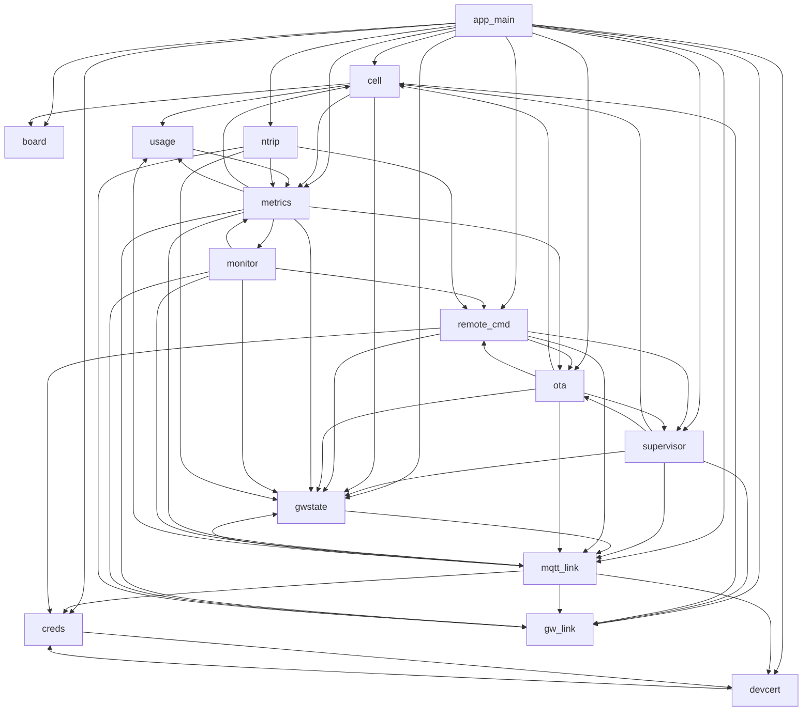
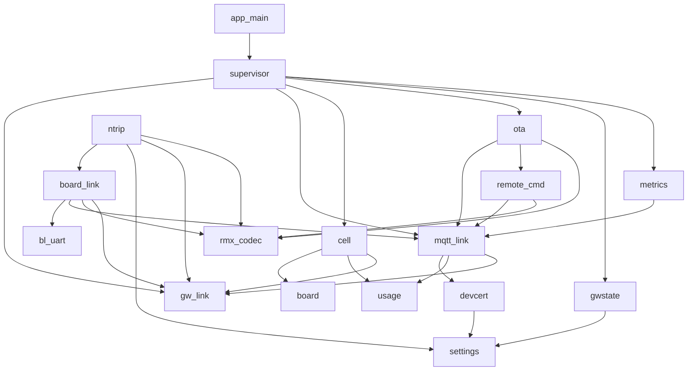
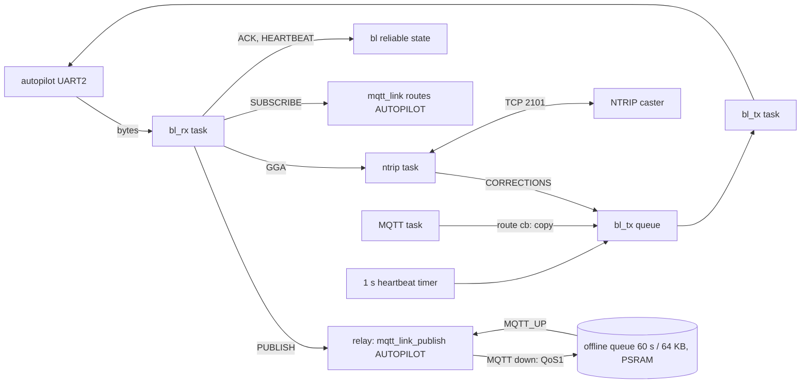

# Mower-Gateway-Architecture: firmware structure, review and target

How the gateway firmware is built, why it was restructured before the board link and the NTRIP client, and what is still open.

**Target architecture (2026-11-23):** the designed target now lives in [`.esp-architecture/`](https://github.com/rmx-lt/rmx-mower-gateway/tree/development/.esp-architecture): the manifest `architecture.yaml`, generated diagrams `diagrams.md`, and decision records DEC-001 to DEC-012, each citing the requirements in `requirements.md` it serves. It replaces the target sketch in §3 below (seven subsystems by external link, five layers with the pure core at the bottom, the MQTT client as a link). The sections below still describe the code as built; the refactor toward the target is planned under [#120](https://github.com/rmx-lt/rmx-mower-gateway/issues/120).

Three kinds of statements, kept apart:

- **Code** — read from the source on `development` (commit `79ee777`, firmware 0.4.0, 2026-11-20, after the refactor epic [rmx-mower-gateway#73](https://github.com/rmx-lt/rmx-mower-gateway/issues/73) and the NTRIP client [#63](https://github.com/rmx-lt/rmx-mower-gateway/issues/63)). Not measured on the board unless it says so.
- **Implemented** — a design from the review (sections 3–7) that is now in the code; the note names the issue and the board check.
- **Open** — designed, not built yet: the board link ([#62](https://github.com/rmx-lt/rmx-mower-gateway/issues/62)) and the task watchdog join.

Related: [Mower-Gateway](Mower-Gateway) (what the firmware does), [Mower-Protocol](Mower-Protocol) §13–§14 (NTRIP, board link), [Mower-Gateway-PPP](Mower-Gateway-PPP), [Mower-Gateway-Server-Contract](Mower-Gateway-Server-Contract).

## 1. Current modules (Code)

17 modules in `main/` (4381 lines with headers) and the pure component `components/rmx_codec` (9 units, 1558 lines). Managed components: `espressif/esp_modem`, `espressif/mqtt`, `espressif/cjson`. Before the refactor (commit `1534b93`, 2026-11-19) it was 11 modules and 3480 lines with no tests off the board.

| Module | Lines | Owns |
|---|---|---|
| `app_main` | 118 | init order, provisioning wait, SNTP (sets `GW_CLOCK_VALID`); returns after start-up |
| `board` | 50 | pins, PWRKEY pulse, STATUS, LED |
| `settings` | 151 | the only NVS opener: strings, u32, blobs, `settings_set_many` (§5.6) |
| `gw_link` | 114 | link-state bits and `GW_EVENT` edges, server-link and 10 s server-lost rule (§4.1) |
| `gw_tasks` | 105 | task table, `gw_task_create`, liveness counters, stack high-water log (§4.3) |
| `supervisor` | 115 | on link events: image confirm, `gateway/state`, final OTA ack, recovery ladder, liveness check, `gw_restart` |
| `cell` | 347 | esp_modem DCE, registration, PPP dial, redial task, AT sessions inside PPP (`cell_with_command_mode`), `cell_reconnect`; registers `signal.rssi`, sets `operator` |
| `usage` | 190 | byte counters: PPP netif (output hook + `--wrap=ip4_input`), MQTT per topic; registers `usage.total.*` |
| `devcert` + `creds` | 319 | P-256 key and chain in NVS `creds`, CSR, UART0 provisioning console, device name = CN |
| `mqtt_link` | 471 | esp-mqtt client, route table (§5.2), reassembly; sets `GW_MQTT_UP` / `GW_SERVER_ONLINE` |
| `remote_cmd` | 289 | `gateway/cmd` route, queue and task, command registry (§5.3), acks |
| `ota` | 666 | chunk download task (parser in `rmx_codec/fw_chunk`), image checks, rollback timer, final ack after restart |
| `gwstate` | 176 | boot counter, clock, NVS `gw` helpers, module-owned `gateway/state` fields (§5.4) |
| `metrics` | 490 | catalogue registry, telemetry, CPU load, the 100 ms `gw_tick` and the 60 s `gw_signal` tasks |
| `monitor` | 303 | monitor sessions (Mower-Protocol §15), `monitor_start` / `monitor_stop` |
| `ntrip` | 477 | NTRIP client: settings in NVS (`ntrip_set`/`ntrip_clear`), TCP session to the caster, GGA schedule, corrections sink, `ntrip` state, `usage.ntrip.*` (§5.5) |

`components/rmx_codec` (pure C, no ESP-IDF or FreeRTOS includes, host-tested, §6): `cobs`, `crc16`, `bl_frame`, `bl_reliable`, `bl_queue` (board link, used by #62), `fw_chunk` (ota), `cmd_core` (remote_cmd), `ntrip_codec` (ntrip), `recovery` (supervisor).

### 1.1 Dependency graph

Arrows are `#include` of another firmware module's header (from the code; `gw_tasks` and `settings` left out: most modules use them).



What the refactor removed: `remote_cmd` no longer includes `cell` or `metrics`, and calls no module's command code (handlers register themselves); `gwstate` no longer includes `cell`; `ntrip` and `monitor` plug in through `cmd_register`, `metrics_register` and `gw_state_set`.

Cycles left, each a narrow call: `remote_cmd ⇄ ota` (`ota_busy()` for the busy check; OTA registers `ota` and sends its acks), `ota ⇄ supervisor` (the supervisor drives confirm and report; `ota`, like `remote_cmd`, only calls `gw_restart()`), `gwstate ⇄ mqtt_link` (publish; the legacy flag through `gw_nvs_*`), `metrics ⇄ monitor`, `metrics ⇄ usage` and `metrics ⇄ cell` (registration one way; the tick reads counters and asks for the signal reading the other way), `devcert ⇄ creds` (a constant). Leaves: `board`, `gw_link`, `gw_tasks`, `settings`. Breaking the rest would need callbacks for one call each; not worth it now.

### 1.2 Tasks

All firmware tasks come from the table in `main/gw_tasks.c` (§4.3).

| Task | Created in | Priority | Stack | Blocks on | Liveness watched |
|---|---|---|---|---|---|
| `main` | IDF | 1 | 8192 (`sdkconfig.defaults`) | start-up only, then returns | — |
| `ntrip` | `ntrip_start` | 6 | 4096 | socket with 1 s receive timeout; 5 s notify wait without settings | yes |
| `cell_wd` | `cell_start` | 5 | 4096 | event group `LOST_IP`, then dial (minutes inside esp_modem) | no (ladder covers it) |
| esp-mqtt | `mqtt_link_start` | IDF default | 8192 | socket; runs all MQTT callbacks | — |
| `remote_cmd` | `remote_cmd_init` | 4 | 6144 | queue of 4 heap-copied commands, 10 s cap | yes |
| `supervisor` | `supervisor_start` | 3 | 6144 | task notification from a `GW_EVENT`, or 1 s | checks the others |
| `gw_tick` | `metrics_start` | 3 | 6144 | `vTaskDelayUntil` 100 ms | yes |
| `ota` | `ota_start` (per update) | 3 | 12288 | queue of 4 heap-copied fw frames, 10 s per chunk | no (OTA pauses the checks) |
| `devcert` | `devcert_console_start` | 3 | 6144 | UART0 byte read | no |
| `gw_signal` | `metrics_start` | 2 | 4096 | 60 s delay, then a 2–3 s AT session | yes |
| esp_timer | IDF | IDF | IDF | OTA rollback callback, server-lost timer | — |
| default event loop | IDF | IDF | IDF | `cell`'s `IP_EVENT` handler, `GW_EVENT` posts | — |

Measured high-water marks: §4.3 (`ntrip`: 2420 bytes free of 4096 while streaming, 2026-11-20).

### 1.3 Communication between tasks

- **Queues**: MQTT task → `remote_cmd` (commands), MQTT task → `ota` (frames, oldest dropped when full). MQTT callbacks copy and return, never block.
- **Link state**: `gw_link` holds the bits of §4.1 in one event group, derives the server link and the 10 s server-lost rule (an `esp_timer`), and posts a `GW_EVENT` per change. Only the supervisor confirms the image, publishes the state on the server-link edge and sends the final OTA ack.
- **Event groups** inside modules: `cell` (`GOT_IP`, `LOST_IP`), `mqtt_link` (`CONNECTED`, `ROUTES_READY`).
- **Mutexes**: `cell` modem lock (redial vs AT session), `remote_cmd` id memory, `metrics` monitor list, `mqtt_link` route table, `ntrip` settings and GGA. `usage` and `ntrip`'s byte counters use spinlocks.
- **Task notifications**: `GW_EVENT` → supervisor; `ntrip_set` / `ntrip_clear` / first GGA → `ntrip`.

### 1.4 Errors and recovery

| Failure | What happens |
|---|---|
| No certificate | `app_main` waits for provisioning, no network |
| At boot: no IP or no clock in time | `gw_restart(reason, 30 s)` |
| PPP lost later | `cell_wd` redials with back-off up to 30 s, PWRKEY power cycle every 5th failure |
| `ATO` fails after an AT session | treated as PPP lost, redial |
| MQTT drops | esp-mqtt reconnects every 10 s; acks queue in the outbox for up to 30 min ([#114](https://github.com/rmx-lt/rmx-mower-gateway/issues/114)) |
| PPP up, MQTT down 5 min | ladder step 1: `cell_reconnect()`, repeated every 5 min (§4.3) |
| Server link down 30 min, or a watched task stuck 120 s | `gw_restart(reason)`, never during an OTA write |
| New image never reaches MQTT | rollback after `CONFIG_GATEWAY_OTA_CONFIRM_S` (300 s) |
| Caster refuses or drops | `ntrip` reconnects after 10 s doubling to 120 s; 401/404 → state `error`, 120 s |
| Crash | core dump to the `coredump` flash partition ([#110](https://github.com/rmx-lt/rmx-mower-gateway/issues/110)) |
| `restart` command, OTA done | `gw_restart()`: the one restart path |

Public functions return `esp_err_t` or `bool`. Protocol error codes are the `CMD_E_*` constants in `cmd_core.h`. `ESP_ERROR_CHECK` is only used during init.

### 1.5 Memory, watchdog, logging, config, tests

- **Memory**: PSRAM on, `SPIRAM_USE_MALLOC`. Steady state is mostly static; JSON is built with cJSON on the heap per message; MQTT fragments over 8192 bytes are reassembled into one heap buffer (limit 128 KB). Buffers: modem UART RX 8192 / TX 2048, DTE 4096, MQTT in 8192 / out 4608, esp-mqtt outbox capped at 32 KB. About 244 KB of internal RAM free (2026-11-20).
- **Watchdog**: the IDF task watchdog on the idle tasks only, logging, no panic. Liveness counters checked by the supervisor do the job for firmware tasks (§4.3).
- **Logging**: one `TAG` per module. Received commands log `<- <cmd> id <id>` only; payloads at debug level, never for `CMD_SECRET_ARGS` commands. Secrets (caster password, key) are never logged.
- **Config**: Kconfig (`Kconfig.projbuild`) holds build-time values: APN, broker URI, OTA confirm time, OTA minimum signal, recovery thresholds, test-only options (all default off). NVS holds runtime state through `settings`: `gw` (boot, OTA state, previous version, legacy flag), `creds` (key, chain), `ntrip` (caster settings). No NVS encryption ([#49](https://github.com/rmx-lt/rmx-mower-gateway/issues/49), deferred by the owner).
- **Tests**: 93 Unity tests of `rmx_codec` on the PC (`pio test -e native`), run by the `host-tests` workflow on every PR. Firmware modules are checked on the board per PR.

## 2. Review findings

The review of the code at `1534b93` (2026-11-19), ranked by what they cost the next features, with the fix proposed. Status 2026-11-20: 1–7 fixed by the epic's steps (§8), 8 by the `monitor` split in #78.

1. **Link state has no owner.** The server-link rule (Mower-Protocol §4.2) lives in `mqtt_link` but is clocked by the metrics task; OTA confirm and result run from two tasks. The board-link heartbeat needs MQTT, server, clock and corrections flags every second. → one `gw_link` event group + events, one supervisor (§5.1).
2. **`mqtt_link` knows every topic.** The board link must subscribe a list the autopilot sends, under another prefix, and replay it on reconnect. → a route table (§5.2).
3. **Dispatch is an if/else chain that knows every module and logs full commands.** `ntrip_set` carries a password that must never be logged. → a command registry with a secret-args flag (§5.3).
4. **State fields and metrics are hard-coded centrally** (`autopilot_link: "down"`, `ntrip: "off"`, one static catalogue). → the owning module sets and registers them (§5.4).
5. **No tests off the board.** COBS, CRC-16, reliable-frame state, the offline queue, NTRIP response parsing and the command id memory are all pure logic. → `components/rmx_codec` + host tests (§6).
6. **No task liveness or recovery ladder.** A stuck task or a half-dead PPP is only fixed by a power cut. → task table, liveness counters, escalation (§4.3).
7. **NVS has four openers.** #37 needs a pending→active swap, #49 changes init, #63 adds a secret. → one settings module (§5.6).
8. **`metrics.c` mixes four jobs** (catalogue, telemetry, monitor, supervisor tick). → split when the tick moves out.

Kept as they are: queues from the MQTT task to workers, `cell_with_command_mode` as the only way to the modem's AT channel (pause-PPP; CMUX was benched in [#19](https://github.com/rmx-lt/rmx-mower-gateway/issues/19) and stays out until [#98](https://github.com/rmx-lt/rmx-mower-gateway/issues/98) decides it, see [Mower-Gateway-PPP](Mower-Gateway-PPP)), static topic strings, Kconfig for build-time values, heap JSON (messages are rare and PSRAM is plentiful).

## 3. Target layers (Implemented, except the board link)

Status: in the code except `board_link` / `bl_uart` (#62). Differences from the sketch: the `rmx_codec` units are named as in §1 (`ntrip_codec`, plus `recovery`); `monitor` sits beside `metrics`; the dependency graph as built is §1.1, with the narrow cycles listed there.

```
L4 app        app_main (init order only), supervisor (link state machine, recovery, OTA confirm/report)
L3 services   mqtt_link (+routes)  board_link  ntrip  remote_cmd (+registry)  ota  gwstate  metrics  monitor  usage
L2 codecs     components/rmx_codec: cobs, crc16, bl_frame, bl_reliable, bl_queue, fw_chunk, cmd_core, ntrip_parse   ← pure C, host-tested
L1 links      cell (modem, PPP, AT sessions)   bl_uart (UART2, RTS/CTS)   TCP socket for NTRIP (lwIP)
L0 platform   board (pins, power)   settings (NVS)   gw_tasks.h (task table)   gw_link (state bits + events)
```

Rules:

- A module calls only down or sideways inside its layer through a public header; upward calls are callbacks or events.
- L2 has no ESP-IDF or FreeRTOS includes; time is passed in as `uint32_t now_ms`.
- Data flows (relay, corrections, chunks) go through queues or stream buffers owned by the receiver. State changes go through `gw_link`. Nothing high-rate goes through the default event loop.



`ota` and `ntrip` register their commands with `remote_cmd`; `remote_cmd` no longer includes them. `gwstate` and `metrics` no longer include `cell`, `ota` or `usage`: those modules push values in.

## 4. Flow

### 4.1 Link state (Implemented)

Implemented in [#75](https://github.com/rmx-lt/rmx-mower-gateway/issues/75); `GW_NTRIP_STREAM` set by `ntrip` since #63; `GW_BL_UP` reserved for #62.

`gw_link` holds level bits in one event group and posts `GW_EVENT` edges on the default loop:

| Bit | Set by | Read by |
|---|---|---|
| `CELL_UP` | `cell` (IP event) | supervisor, ota, metrics |
| `MQTT_UP` | `mqtt_link` | supervisor, board_link heartbeat bit 0 |
| `SERVER_ONLINE` | `mqtt_link` (retained `mower/status/server`) | heartbeat bit 1 |
| `SERVER_LINK_UP` | `gw_link` (MQTT_UP ∧ SERVER_ONLINE) | supervisor, monitor |
| `SERVER_LOST` | `gw_link` esp_timer, 10 s after LINK_UP falls | monitor (end sessions) |
| `CLOCK_VALID` | SNTP callback | heartbeat bit 3, remote_cmd (`expires_at`) |
| `BL_UP` | `board_link` | gwstate `autopilot_link`, ntrip (GGA expected) |
| `NTRIP_STREAMING` | `ntrip` | heartbeat bit 2 |

On `SERVER_LINK_UP` the supervisor, and only it: confirms the image, publishes state and catalogue, reports the OTA result.

### 4.2 Board link and NTRIP data paths (Open: board link)

The `ntrip` side is built (#63): its socket, the GGA schedule, the byte counters (registered by `ntrip` itself, not through `usage`). Until #62 the corrections sink is empty (bytes counted and dropped) and GGA only comes from the test option. The board-link side below is the design for #62.



- `bl_rx` decodes frames (`rmx_codec`), acks reliable frames, and hands each frame to its consumer without blocking: relay publishes (esp-mqtt's publish takes its own lock), GGA goes to the ntrip queue (oldest dropped), SUBSCRIBE replaces the route list.
- `bl_tx` is the only writer to UART2. It sends one reliable frame at a time from the reliable queue (resend after 200 ms, 5 times) and interleaves unreliable frames (corrections, heartbeats, acks) between them.
- MQTT callbacks for autopilot topics copy into the `bl_tx` queue and return; while `BL_UP` is clear they drop and count (Mower-Protocol §14.2).
- `ntrip` owns its socket and reconnects on its own; it never touches MQTT. Its byte counters go to `usage`.

### 4.3 Tasks and recovery (Implemented, except the task watchdog join)

Design task table, one header `main/gw_tasks.h` ([rmx-mower-gateway#79](https://github.com/rmx-lt/rmx-mower-gateway/issues/79)). Priorities are relative; stacks are starting values to resize from measured high-water marks.

| Task | Priority | Stack | Note |
|---|---|---|---|
| `bl_rx` | 10 | 4096 | 921600 baud with RTS/CTS: the UART driver buffers, flow control covers a late reader |
| `bl_tx` | 9 | 4096 | the only UART2 writer |
| `ntrip` | 6 | 4096 | plain TCP, blocking socket with timeouts |
| esp-mqtt | 5 | 8192 | unchanged |
| `cell` | 5 | 4096 | redial; also does the 60 s signal reading (replaces `gw_signal`) |
| `remote_cmd` | 4 | 6144 | unchanged |
| `supervisor` | 3 | 6144 | replaces `gw_tick` and the `app_main` loop |
| `ota` | 3 | 12288 | per update |
| `devcert` | 2 | 4096 | console |

Recovery ladder in the supervisor (thresholds in Kconfig, tuned with [#16](https://github.com/rmx-lt/rmx-mower-gateway/issues/16)):

1. MQTT down, PPP up, 5 min → `cell_reconnect()` (hang up and redial).
2. PPP redial fails → `cell` power-cycles the modem (as today).
3. Server link down 30 min, or a firmware task's liveness counter stale for 120 s → `gw_restart(reason)`. Never during an OTA write.

The decisions of steps 1 and 3 are pure and host-tested in `components/rmx_codec/recovery.h` ([#100](https://github.com/rmx-lt/rmx-mower-gateway/issues/100)): `rec_step()` (a reconnect repeats every 5 min while MQTT stays down with PPP up; an OTA write pauses both clocks and starts them over) and `live_check()` over the loop counters. The supervisor wiring is #79.

The task watchdog alone does not fit: `cell` legitimately blocks for minutes inside esp_modem calls. Liveness counters checked by the supervisor do, and short-loop tasks (`bl_rx`, `bl_tx`, supervisor) also join the task watchdog.

**Implemented in [#79](https://github.com/rmx-lt/rmx-mower-gateway/issues/79)** (verified on the board 2026-11-20):
- `main/gw_tasks.h/.c`: the table of today's tasks (`remote_cmd` 4/6144, `gw_tick` 3/6144, `gw_signal` 2/4096, `ntrip` 6/4096 since #63, `cell_wd` 5/4096, `supervisor` 3/6144, `ota` 3/12288, `devcert` 3/6144; see §1.2). Every module creates its task with `gw_task_create()`. `bl_rx` and `bl_tx` join with #62. `gw_tick` and `gw_signal` stayed in `metrics` instead of moving into the supervisor and `cell`.
- Liveness: `remote_cmd` (queue wait capped at 10 s), `gw_tick`, `gw_signal` and `ntrip` (at least once a second) call `gw_task_alive()` once per loop. The supervisor restarts the board when one has not counted for `CONFIG_GATEWAY_LIVE_STALE_S` (120 s), never during an update. `cell_wd` is not watched: it blocks for minutes inside esp_modem while redialling, and step 3 covers it. `devcert` waits on the console.
- Ladder: the thresholds are `CONFIG_GATEWAY_REC_MQTT_DOWN_S` (300) and `CONFIG_GATEWAY_REC_LINK_DOWN_S` (1800). Step 1 calls `cell_reconnect()` (command mode, then the redial task dials again).
- Open: the task watchdog join. Here the task watchdog only logs (`CONFIG_ESP_TASK_WDT_PANIC` off, 5 s), and the supervisor can block on a publish for longer than that. The core dump went to flash in [#110](https://github.com/rmx-lt/rmx-mower-gateway/issues/110) (owner decision 2026-11-20).
- Board checks: a test build whose `ping` blocks `remote_cmd` for 200 s logged `restarting in 0 ms: task remote_cmd did not loop for 120 s` and booted clean. A test build with the clock shifted 400 days (TLS refused, PPP up) and thresholds 60/300 s logged `MQTT down with PPP up for 60 s: reconnecting the cell` every ~62 s (each redial got PPP back in about 150 ms), then `server link down too long` at 306 s.

Free stack, smallest seen (bytes, high-water mark from the 60 s alive log `tasks: stack free`), over a normal run, an OTA, a restart and the redial test:

| Task | Stack | Smallest free |
|---|---|---|
| `remote_cmd` | 6144 | 4012 |
| `gw_tick` | 6144 | 4260 |
| `gw_signal` | 4096 | 2848 |
| `cell_wd` | 4096 | 2464 (after redials) |
| `supervisor` | 6144 | 3544 |
| `ota` | 12288 | 9596 (during the download; the signature check at the end is not in this sample) |
| `devcert` | 6144 | 5272 (idle; provisioning not measured) |
| `ntrip` | 4096 | 2420 (streaming, #63) |
| `mqtt_task` (esp-mqtt) | sdkconfig | 4528 |
| `tcpip` (lwIP) | sdkconfig | 2836 |
| `sys_evt` | sdkconfig | 1532 |

No resize for now: about 244 KB of internal RAM is free, and the paths not measured (OTA signature check, provisioning) could need more.

## 5. Interfaces

Names follow §7. 5.1–5.4 and 5.6 are implemented; the code blocks are the design sketches, and each subsection says where the real header differs. 5.5: `ntrip.h` implemented, `board_link.h` open (#62).

### 5.1 `gw_link.h`

Implemented in [#75](https://github.com/rmx-lt/rmx-mower-gateway/issues/75) (verified on the board 2026-11-20).

```c
#define GW_CELL_UP        BIT0
#define GW_MQTT_UP        BIT1
#define GW_SERVER_ONLINE  BIT2
#define GW_SERVER_LINK_UP BIT3
#define GW_SERVER_LOST    BIT4
#define GW_CLOCK_VALID    BIT5
#define GW_BL_UP          BIT6
#define GW_NTRIP_STREAM   BIT7
ESP_EVENT_DECLARE_BASE(GW_EVENT);           /* event id = bit index, data = bool level */
esp_err_t   gw_link_init(void);
void        gw_link_set(EventBits_t bit, bool on);   /* posts GW_EVENT on change */
EventBits_t gw_link_get(void);
bool        gw_link_wait(EventBits_t all, int timeout_ms);
```

### 5.2 `mqtt_link.h` (routes)

Implemented in [#76](https://github.com/rmx-lt/rmx-mower-gateway/issues/76) (verified on the board 2026-11-20, PR #92).

```c
typedef enum { MQTT_SCOPE_GATEWAY, MQTT_SCOPE_AUTOPILOT, MQTT_SCOPE_ABSOLUTE } mqtt_scope_t;
typedef void (*mqtt_route_cb_t)(const char *subtopic, const uint8_t *data, size_t len, void *ctx);
#define MQTT_ROUTE_READY 0x1                      /* counts for mqtt_link_wait_ready() */
esp_err_t mqtt_link_route(mqtt_scope_t, const char *subtopic, int qos, unsigned flags,
                          mqtt_route_cb_t cb, void *ctx);   /* subscribed now and on every connect */
esp_err_t mqtt_link_unroute(mqtt_scope_t, const char *subtopic);
esp_err_t mqtt_link_start(void);
bool      mqtt_link_wait_ready(int timeout_ms);  /* connected and every READY route has its SUBACK */
esp_err_t mqtt_link_publish(mqtt_scope_t, const char *subtopic, const char *payload, int len,
                            int qos, bool retain);   /* len 0 = strlen */
```

- Scopes: `mower/<name>/gateway/<sub>`, `mower/<name>/autopilot/<sub>`, or `<sub>` as the whole topic. No wildcards.
- 24 routes; routes may be added before `mqtt_link_start()` (topics are built at start) or while connected (subscribed at once). The same scope and subtopic again replaces the handler.
- Callbacks run on the MQTT task, outside the table lock, and must not block.
- Current routes: `mower/status/server` (mqtt_link itself, sets `GW_SERVER_ONLINE`), `gateway/cmd` (remote_cmd), `gateway/fw/chunk` and `gateway/fw/res` (ota, both `MQTT_ROUTE_READY`, registered in `ota_boot_init()`). `ntrip` needs none (commands come through the registry).
- `mqtt_link_stop()` is not implemented: nothing needs it yet.

### 5.3 `remote_cmd.h` (registry)

```c
typedef struct { const char *error; const char *message; cJSON *result; bool accepted; bool restart; } cmd_reply_t;
typedef void (*cmd_fn_t)(const char *id, const cJSON *cmd, cmd_reply_t *reply);
#define CMD_DURING_OTA   0x1
#define CMD_SECRET_ARGS  0x2   /* never log the arguments, not even at debug level */
esp_err_t remote_cmd_init(void);
esp_err_t cmd_register(const char *name, cmd_fn_t fn, unsigned flags);
void      cmd_ack(const char *id, const char *cmd, const char *state, const char *error,
                  const char *message, cJSON *result);       /* unchanged, for async finals */
```

`components/rmx_codec/include/cmd_core.h` holds the pure part: `cmd_id_valid()`, `cmd_name_valid()`, the id memory (`cmd_mem_find/store`, time passed in), the `expires_at` check (`cmd_check_expires`) and the error codes (`CMD_E_*`). Implemented and host-tested in [#94](https://github.com/rmx-lt/rmx-mower-gateway/issues/94).

Registry implemented in [#77](https://github.com/rmx-lt/rmx-mower-gateway/issues/77) (verified on the board 2026-11-20):
- A table of 16. `remote_cmd` registers `ping`, `restart`, `autopilot_reset` (answers failed until #62 wires the line); `ota_boot_init()` registers `ota`; `monitor_init()` registers `monitor_start`/`monitor_stop` with `CMD_DURING_OTA`; `ntrip_start()` registers `ntrip_set` (`CMD_SECRET_ARGS`) and `ntrip_clear` (#63).
- At info level every command logs only `<- <cmd> id <id>`; the payload is logged at debug level only for a registered command without `CMD_SECRET_ARGS`.
- Order in the dispatcher: id/name check, repeated id (repeat the last ack), `expires_at`, unknown (`unknown_cmd`, message lists the registered names), busy during OTA, then the handler. A handler that leaves `error` NULL and `accepted` false gets a `done` ack with its `result`.
- `reply.restart` restarts through `gw_restart(reason, delay_ms)` (supervisor), the one deliberate restart path: logs the reason, waits, stops MQTT and PPP, restarts. OTA and the boot-failure restart use it too.

### 5.4 State and metrics

Implemented in [#78](https://github.com/rmx-lt/rmx-mower-gateway/issues/78) (verified on the board 2026-11-20, PR #93).

```c
void      gw_state_set(const char *field, const char *value);   /* NULL = JSON null, copied */
void      gw_state_publish(bool force);
typedef bool (*metric_read_fn)(void *ctx, double *out);
esp_err_t metrics_register(const metric_def_t *def, metric_read_fn fn, void *ctx);  /* before the first catalogue */
```

- `gateway/state` fields after the fixed ones (protocol, boot, firmware, previous, partition) come from `gw_state_set`, in the order first set; `autopilot_link` ("down"), `ntrip` ("off") and `operator` (null) exist from boot. `cell` sets `operator` after each AT+COPS read.
- Who registers what: `cell_start()` registers `signal.rssi`; the first `usage_attach_netif()` registers `usage.total.up|down`; `ntrip_start()` registers `usage.ntrip.up|down` (catalogue revision 2); `metrics_start()` registers the `system.*` metrics and then the `usage.mqtt.up|down.*` families. Within a catalogue part, metrics come in registration order. The same name again is ignored; a new name after the catalogue went out is refused (bump `CATALOGUE_REVISION` when the set changes).
- Monitor sessions (§15) live in `monitor.c`; `metrics.c` keeps the catalogue, telemetry and the 100 ms tick.
- `usage_count(name, up, bytes)` was not needed: `ntrip` counts its own socket bytes and registers `usage.ntrip.up|down` itself ([#63](https://github.com/rmx-lt/rmx-mower-gateway/issues/63)); a shared helper can come with a second user.

### 5.5 `board_link.h` (Open, #62) and `ntrip.h` (Implemented)

```c
typedef enum { BL_DOWN, BL_UP, BL_INCOMPATIBLE } bl_state_t;
esp_err_t  board_link_start(void);
bl_state_t board_link_state(void);
esp_err_t  board_link_send_corrections(const uint8_t *data, size_t len);   /* drops when full */
void       board_link_set_gga_cb(void (*cb)(const char *nmea, size_t len));
esp_err_t  board_link_reset_autopilot(void);

typedef enum { NTRIP_OFF, NTRIP_WAITING, NTRIP_CONNECTING, NTRIP_STREAMING, NTRIP_ERROR } ntrip_state_t;
esp_err_t     ntrip_start(void);              /* loads settings; registers ntrip_set / ntrip_clear */
void          ntrip_feed_gga(const char *nmea, size_t len);
ntrip_state_t ntrip_state(void);
```

Pure parts in `rmx_codec`: `cobs_encode/decode`, `crc16_ccitt_false`, `bl_frame_pack/parse`, `bl_reliable_*` (sequence, ack, resend decisions from `now_ms`), `bl_queue_*` (the 60 s / 64 KB ring, drop-oldest), `ntrip_build_request`, `ntrip_parse_response`, `nmea_gga_has_position`.

**Implemented in [#63](https://github.com/rmx-lt/rmx-mower-gateway/issues/63)** (verified on the board 2026-11-20, without the autopilot): `main/ntrip.h` has `ntrip_start()`, `ntrip_feed_gga()` and `ntrip_set_sink()` (the board link's CORRECTIONS writer, #62); the state is reported through `gw_state_set("ntrip", …)` and `GW_NTRIP_STREAM` rather than an `ntrip_state()` getter. It stays in `main/` (no `components/ntrip/`): it needs `remote_cmd`, `settings`, `metrics` and `gw_link`. Details in [Mower-Gateway](Mower-Gateway) "NTRIP client".

The NTRIP parts are implemented and host-tested in [#96](https://github.com/rmx-lt/rmx-mower-gateway/issues/96) (`ntrip_codec.h`). Rev 1 (`HTTP/1.0`, raw stream, GGA after the headers) and rev 2 (`HTTP/1.1`, `Ntrip-Version: Ntrip/2.0`, GGA in `Ntrip-GGA`, chunked answers decoded by `ntrip_chunk_decode`) since [#103](https://github.com/rmx-lt/rmx-mower-gateway/issues/103), which also added the GGA schedule (`ntrip_gga_offer/due`: a new sentence with a position at once, the last one again every 10 s) and `ntrip_request_masked()`: the client logs the masked copy, never the request, which holds the Base64 credentials. Settings with control characters (or spaces in host and mount point, `:` in the user) are refused, so a stored setting cannot inject a header.

### 5.6 `settings.h`

```c
esp_err_t settings_init(void);   /* nvs_flash_init now, nvs_flash_secure_init with #49 */
esp_err_t settings_get_str(const char *ns, const char *key, char *buf, size_t len);
esp_err_t settings_set_str(const char *ns, const char *key, const char *val);
esp_err_t settings_get_blob(const char *ns, const char *key, void *buf, size_t *len);
esp_err_t settings_set_blob(const char *ns, const char *key, const void *val, size_t len);
esp_err_t settings_erase(const char *ns, const char *key);
```

Kconfig keeps build-time values (APN, broker URI, timeouts, pins of the board link). NVS keeps what changes at runtime or per board (identity, NTRIP settings, OTA state, counters).

**Implemented in [#80](https://github.com/rmx-lt/rmx-mower-gateway/issues/80)** (verified on the board 2026-11-20). `main/settings.h/.c` is now the only code that opens NVS. Besides the calls above it has `settings_get_u32/set_u32` (the boot counter) and `settings_set_many(ns, kv, n)`: several strings in one open and one commit, with `val` NULL to erase. Writing them is not atomic; that is enough for the OTA keys, and #37's pending → active swap will need a pointer key on top. Namespaces and keys are unchanged ("gw": `boot`, `ota_id`/`ota_ver`/`ota_prev`, `prev`/`prev_of`, `legacy`; "creds": `key`, `chain`), so no migration. `gw_nvs_*` and devcert's helpers are thin wrappers over it. The module logs namespace and key on a failed write, never a value. `metrics` still reads `nvs_get_stats()` directly (read-only, no handle).

Board check: USB-flashed development as 0.4.1-dev (boot 69), then OTA to 0.4.2-pr80. The OTA keys written by the old code were read by the new code: the done ack had previous 0.4.1-dev, the boot counter went to 70, and the key and chain loaded (cert login). An OTA to 0.4.3-pr80 then had its keys written and read by the new code: done ack, boot 71. A restart kept `previous` 0.4.2-pr80 (boot 72).

## 6. Directory layout and host tests (Implemented)

```
main/                     all firmware modules of §1, Kconfig.projbuild
components/
  rmx_codec/              pure C99 + include/; CMakeLists with no IDF REQUIRES
test/                     Unity tests of rmx_codec (test_<name>/), run on the PC and in CI
```

The design had `components/board_link/` and `components/ntrip/`. `ntrip` stayed in `main/` because it needs `remote_cmd`, `settings`, `metrics` and `gw_link` (its pure part is `rmx_codec/ntrip_codec`); #62 decides the same for the board link.

No big-bang move of the existing modules: a module moves to `components/` only when a step rewrites it. Host test runner: PlatformIO's `native` env (`pio test -e native`, Unity, `lib_extra_dirs = components` with a `library.json` in `rmx_codec`), chosen in [rmx-mower-gateway#74](https://github.com/rmx-lt/rmx-mower-gateway/issues/74) because PlatformIO is already the main tool; tests sit in `test/test_<name>/`, the `host-tests` workflow runs them on every PR. The ESP-IDF `linux` target is not needed while L2 stays free of FreeRTOS.

## 7. Conventions

Rules for new and touched code. Followed by the modules written in the epic; the exceptions are named below.

- **Names**: public functions carry the module prefix, equal to the file name (`cell_`, `mqtt_link_`, `board_link_`, `ntrip_`, `settings_`). Exceptions kept: `remote_cmd` exports `cmd_register` / `cmd_ack`, `gwstate` exports `gw_*`, `supervisor` exports `gw_restart`.
- **Errors**: fallible functions return `esp_err_t`; predicates return `bool`. Protocol error codes (`bad_request`, `busy`, …) are the `CMD_E_*` constants in `cmd_core.h`. `ESP_ERROR_CHECK` only in init paths that cannot continue.
- **Callbacks** run on the caller's task and never block; they copy and queue.
- **Memory**: fixed-size buffers for the board link (frames ≤ 4608 bytes before COBS) and the offline queue in PSRAM; UART driver buffers in internal RAM.
- **Logging**: INFO for state changes, DEBUG for per-message traffic (relay, corrections), never secrets (`CMD_SECRET_ARGS`, settings flagged secret).
- **Init order** (`app_main`). The design below; the code follows it except that `board_link_start` does not exist yet, `cell_start` still blocks (60 s, then up to 180 s more for an IP, else `gw_restart`) in `app_main`, SNTP must set the clock before `mqtt_link_start`, and `ntrip_start` / `metrics_start` / `supervisor_start` run after `remote_cmd_init`, before the MQTT connect:

| # | Step | Why here |
|---|---|---|
| 1 | `settings_init`, boot counter | everything below reads NVS |
| 2 | `devcert_init`, console | no identity → stop here, wait for provisioning |
| 3 | `ota_boot_init` | rollback timer starts as early as possible |
| 4 | `esp_netif_init`, default event loop, `gw_link_init` | before any module posts events |
| 5 | `board_init`, `board_link_start` | the autopilot link works without LTE |
| 6 | module registration: commands, routes, metrics, state fields | before the first connect and catalogue |
| 7 | `remote_cmd_init`, `mqtt_link_start`, `ntrip_start` | they wait on `gw_link` bits themselves |
| 8 | `cell_start` (non-blocking), SNTP | the supervisor handles "no IP" instead of `app_main` |
| 9 | `supervisor_start` | `app_main` returns |

## 8. Refactor steps

Epic [rmx-mower-gateway#73](https://github.com/rmx-lt/rmx-mower-gateway/issues/73), **done 2026-11-20**: every step merged and checked on the board. Each step merged on its own and kept behaviour and the MQTT contract.

| # | Issue | Needs | Before |
|---|---|---|---|
| 1 | [#74](https://github.com/rmx-lt/rmx-mower-gateway/issues/74) host tests, `rmx_codec`, fw chunk parser | — | #62 |
| 2 | [#75](https://github.com/rmx-lt/rmx-mower-gateway/issues/75) `gw_link` events and supervisor | — | #62, #63 |
| 3 | [#76](https://github.com/rmx-lt/rmx-mower-gateway/issues/76) MQTT route table | — | #62 |
| 4 | [#77](https://github.com/rmx-lt/rmx-mower-gateway/issues/77) command registry, command core tests | 1, 3 | #62, #63 |
| 5 | [#78](https://github.com/rmx-lt/rmx-mower-gateway/issues/78) module-owned state fields and metrics | 2 | #62, #63 |
| 6 | [#79](https://github.com/rmx-lt/rmx-mower-gateway/issues/79) task table, liveness, recovery ladder | 2 | — |
| 7 | [#80](https://github.com/rmx-lt/rmx-mower-gateway/issues/80) settings module | — | #37, #49 |

Also part of the epic: [#83](https://github.com/rmx-lt/rmx-mower-gateway/issues/83) (ota.c on `rmx_codec`'s chunk parser).

Then the features: NTRIP [#63](https://github.com/rmx-lt/rmx-mower-gateway/issues/63) (done 2026-11-20, RTK fix check in [#117](https://github.com/rmx-lt/rmx-mower-gateway/issues/117)), board link [#62](https://github.com/rmx-lt/rmx-mower-gateway/issues/62), certificate renewal [#37](https://github.com/rmx-lt/rmx-mower-gateway/issues/37), flash/NVS encryption [#49](https://github.com/rmx-lt/rmx-mower-gateway/issues/49).
