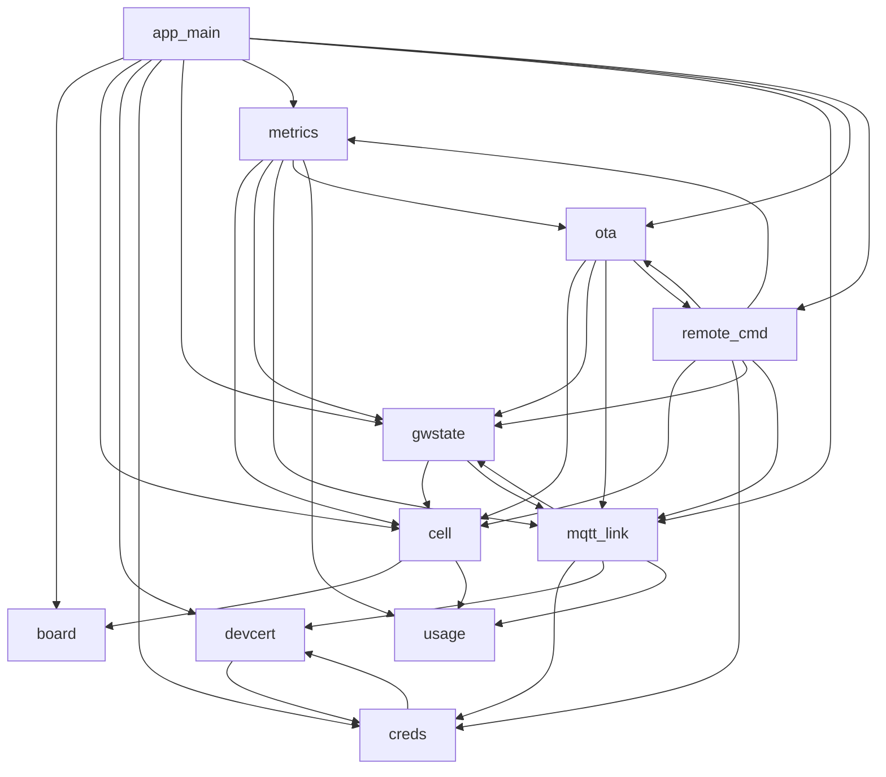
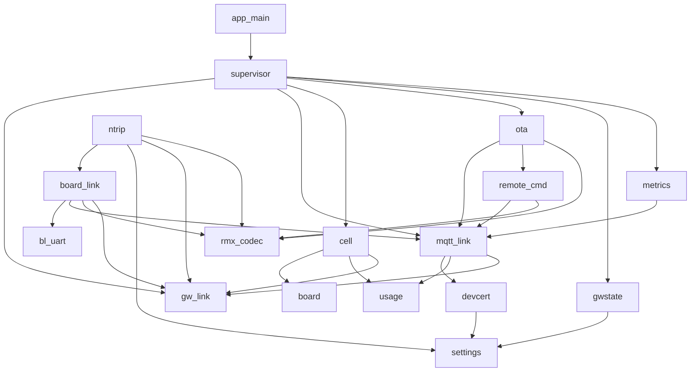
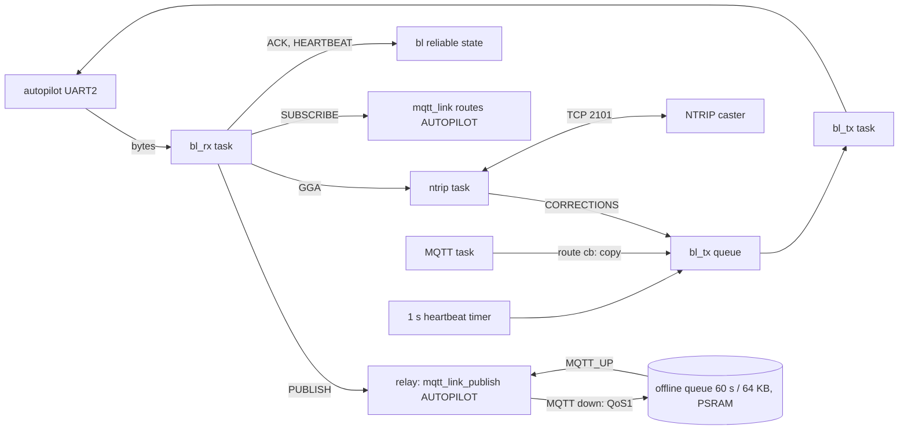

# Mower-Gateway-Architecture: firmware structure, review and target

How the gateway firmware in `main/` is built today, what to change before the board link and the NTRIP client land, and in which order.

Two kinds of statements, kept apart:

- **Code** — read from the source on `development` (commit `1534b93`, firmware 0.4.0, 2026-11-19). Not measured on the board unless it says so.
- **Proposal** — the target. Each step is an issue under the epic [rmx-mower-gateway#73](https://github.com/rmx-lt/rmx-mower-gateway/issues/73); this page changes when a step merges.

Related: [Mower-Gateway](Mower-Gateway) (what the firmware does), [Mower-Protocol](Mower-Protocol) §13–§14 (NTRIP, board link), [Mower-Gateway-PPP](Mower-Gateway-PPP), [Mower-Gateway-Server-Contract](Mower-Gateway-Server-Contract).

## 1. Current modules (Code)

11 modules, 3480 lines, one ESP-IDF component (`main/`). Managed components: `espressif/esp_modem`, `espressif/mqtt`, `espressif/cjson`.

| Module | Lines | Owns |
|---|---|---|
| `app_main` | 108 | boot sequence, provisioning wait, SNTP, 60 s alive loop |
| `board` | 61 | pins, PWRKEY pulse, STATUS, LED |
| `cell` | 346 | esp_modem DCE, registration, PPP dial, redial task, AT sessions inside PPP (`cell_with_command_mode`) |
| `usage` | 199 | byte counters: PPP netif (output hook + `--wrap=ip4_input`), MQTT per topic |
| `devcert` + `creds` | 366 | P-256 key and chain in NVS `creds`, CSR, UART0 provisioning console, device name = CN |
| `mqtt_link` | 380 | esp-mqtt client, fixed topic list, reassembly, server-online flag, 10 s server-lost timer |
| `remote_cmd` | 355 | `gateway/cmd` queue and task, id memory (16 ids, 3 min), acks, dispatch |
| `ota` | 725 | chunk download task, image checks, rollback timer, final ack after restart |
| `gwstate` | 175 | boot counter, clock, NVS `gw` helpers, `gateway/state` |
| `metrics` | 765 | catalogue, telemetry, monitor sessions, CPU load, **and** the 100 ms tick task that drives state, OTA confirm and result |

### 1.1 Dependency graph

Arrows are `#include` of another module's header (from the code).



Cycles: `mqtt_link ⇄ gwstate` (transport uses the NVS helpers, state publishes through transport), `remote_cmd ⇄ ota` (dispatch calls `ota_start`, OTA calls `cmd_ack`), `remote_cmd → metrics → ota → remote_cmd`, `devcert ⇄ creds` (a constant). Only `board` and `usage` are leaves.

### 1.2 Tasks

| Task | Created in | Priority | Stack | Blocks on |
|---|---|---|---|---|
| `main` | IDF | 1 (IDF default) | 8192 (`sdkconfig.defaults`) | 60 s delay loop |
| `cell_wd` | `cell_start` | 5 | 4096 | event group `LOST_IP`, then dial (AT sync, registration and IP waits: minutes inside esp_modem calls) |
| esp-mqtt | `mqtt_link_start` | IDF default | 8192 | socket; runs all MQTT callbacks |
| `remote_cmd` | `remote_cmd_init` | 4 | 6144 | queue of 4 heap-copied commands |
| `gw_tick` | `metrics_start` | 3 | 6144 | `vTaskDelayUntil` 100 ms |
| `gw_signal` | `metrics_start` | 2 | 4096 | 60 s delay, then a 2–3 s AT session |
| `ota` | `ota_start` (per update) | 3 | 12288 | queue of 4 heap-copied fw frames, 10 s per chunk |
| `devcert` | `devcert_console_start` | 3 | 6144 | UART0 byte read |
| esp_timer | IDF | IDF | IDF | runs the OTA rollback callback |
| default event loop | IDF | IDF | IDF | runs `cell`'s `IP_EVENT` handler |

Stack high-water marks have not been measured.

### 1.3 Communication between tasks

- **Queues** (good): MQTT task → `remote_cmd` (commands), MQTT task → `ota` (frames, oldest dropped when full). MQTT callbacks copy and return, never block.
- **Event groups**: `cell` (`GOT_IP`, `LOST_IP`), `mqtt_link` (`CONNECTED`, fw SUBACKs).
- **Mutexes**: `cell` modem lock (redial vs AT session), `remote_cmd` id memory, `metrics` monitor list. `usage` uses a spinlock (called from lwIP).
- **Shared variables without a lock**: `volatile bool` flags in `mqtt_link` and `ota` (fine, single writer); `cell`'s `s_rssi` (`int`, briefly 99 while registering) and `s_operator` (a string the redial rewrites while `gwstate` may read it).
- **Polling**: `gw_tick` calls `mqtt_link_update()` every 100 ms to time the server link, publishes state on change once a second, and calls `ota_confirm()` / `ota_report_result()`. `app_main` calls the same two OTA functions every 60 s: two tasks can send the final OTA ack.

### 1.4 Errors and recovery

| Failure | What happens |
|---|---|
| No certificate | `app_main` waits forever for provisioning, no network |
| At boot: `cell_start(60 s)` fails and no IP in another 180 s | `cell_stop`, `esp_restart` |
| PPP lost later | `cell_wd` redials with back-off up to 30 s, PWRKEY power cycle every 5th failure; never restarts the ESP |
| `ATO` fails after an AT session | treated as PPP lost, redial |
| MQTT drops | esp-mqtt reconnects every 10 s, forever |
| PPP up but no MQTT for a long time | nothing escalates ([rmx-mower-gateway#16](https://github.com/rmx-lt/rmx-mower-gateway/issues/16)) |
| New image never reaches MQTT | rollback after `CONFIG_GATEWAY_OTA_CONFIRM_S` (300 s) |
| `restart` command, OTA done | `mqtt_link_stop`, `cell_stop`, `esp_restart` (the same sequence in two places) |

Public functions return `esp_err_t` or `bool`; protocol error codes are string literals spread over `remote_cmd` and `ota`. `ESP_ERROR_CHECK` is only used during init.

### 1.5 Memory, watchdog, logging, config

- **Memory**: PSRAM on, `SPIRAM_USE_MALLOC`. Steady state is mostly static; JSON is built with cJSON on the heap per message; MQTT fragments over 8192 bytes are reassembled into one heap buffer (limit 128 KB). Buffers: modem UART RX 8192 / TX 2048, DTE 4096, MQTT in 8192 / out 4608.
- **Watchdog**: not set in `sdkconfig.defaults`, so the IDF defaults apply (task watchdog on the idle tasks only). No firmware task subscribes to it; no core dump partition in `partitions.csv`.
- **Logging**: one `TAG` per module. Every QoS 1 publish and every received command is logged at INFO with up to 300 bytes of payload.
- **Config**: Kconfig (`Kconfig.projbuild`) holds build-time values: APN, broker URI, OTA confirm time, OTA minimum signal. NVS holds runtime state: `gw` (boot, OTA state, previous version, legacy flag), `creds` (key, chain). No NVS encryption ([rmx-mower-gateway#49](https://github.com/rmx-lt/rmx-mower-gateway/issues/49)).
- **Tests**: none off the board.

## 2. Review findings

Ranked by what they cost the next features. **Code** facts, **Proposal** fixes.

1. **Link state has no owner.** The server-link rule (Mower-Protocol §4.2) lives in `mqtt_link` but is clocked by the metrics task; OTA confirm and result run from two tasks. The board-link heartbeat needs MQTT, server, clock and corrections flags every second. → one `gw_link` event group + events, one supervisor (§5.1).
2. **`mqtt_link` knows every topic.** The board link must subscribe a list the autopilot sends, under another prefix, and replay it on reconnect. → a route table (§5.2).
3. **Dispatch is an if/else chain that knows every module and logs full commands.** `ntrip_set` carries a password that must never be logged. → a command registry with a secret-args flag (§5.3).
4. **State fields and metrics are hard-coded centrally** (`autopilot_link: "down"`, `ntrip: "off"`, one static catalogue). → the owning module sets and registers them (§5.4).
5. **No tests off the board.** COBS, CRC-16, reliable-frame state, the offline queue, NTRIP response parsing and the command id memory are all pure logic. → `components/rmx_codec` + host tests (§6).
6. **No task liveness or recovery ladder.** A stuck task or a half-dead PPP is only fixed by a power cut. → task table, liveness counters, escalation (§4.3).
7. **NVS has four openers.** #37 needs a pending→active swap, #49 changes init, #63 adds a secret. → one settings module (§5.6).
8. **`metrics.c` mixes four jobs** (catalogue, telemetry, monitor, supervisor tick). → split when the tick moves out.

Kept as they are: queues from the MQTT task to workers, `cell_with_command_mode` as the only way to the modem's AT channel (pause-PPP; CMUX was benched in [#19](https://github.com/rmx-lt/rmx-mower-gateway/issues/19) and stays out until [#98](https://github.com/rmx-lt/rmx-mower-gateway/issues/98) decides it, see [Mower-Gateway-PPP](Mower-Gateway-PPP)), static topic strings, Kconfig for build-time values, heap JSON (messages are rare and PSRAM is plentiful).

## 3. Target layers (Proposal)

```
L4 app        app_main (init order only), supervisor (link state machine, recovery, OTA confirm/report)
L3 services   mqtt_link (+routes)  board_link  ntrip  remote_cmd (+registry)  ota  gwstate  metrics  monitor  usage
L2 codecs     components/rmx_codec: cobs, crc16, bl_frame, bl_reliable, bl_queue, fw_chunk, cmd_core, ntrip_parse   ← pure C, host-tested
L1 links      cell (modem, PPP, AT sessions)   bl_uart (UART2, RTS/CTS)   TCP socket for NTRIP (lwIP)
L0 platform   board (pins, power)   settings (NVS)   gw_tasks.h (task table)   gw_link (state bits + events)
```

Rules:

- A module calls only down or sideways inside its layer through a public header; upward calls are callbacks or events.
- L2 has no ESP-IDF or FreeRTOS includes; time is passed in as `uint32_t now_ms`.
- Data flows (relay, corrections, chunks) go through queues or stream buffers owned by the receiver. State changes go through `gw_link`. Nothing high-rate goes through the default event loop.



`ota` and `ntrip` register their commands with `remote_cmd`; `remote_cmd` no longer includes them. `gwstate` and `metrics` no longer include `cell`, `ota` or `usage`: those modules push values in.

## 4. Flow (Proposal)

### 4.1 Link state

`gw_link` holds level bits in one event group and posts `GW_EVENT` edges on the default loop:

| Bit | Set by | Read by |
|---|---|---|
| `CELL_UP` | `cell` (IP event) | supervisor, ota, metrics |
| `MQTT_UP` | `mqtt_link` | supervisor, board_link heartbeat bit 0 |
| `SERVER_ONLINE` | `mqtt_link` (retained `mower/status/server`) | heartbeat bit 1 |
| `SERVER_LINK_UP` | `gw_link` (MQTT_UP ∧ SERVER_ONLINE) | supervisor, monitor |
| `SERVER_LOST` | `gw_link` esp_timer, 10 s after LINK_UP falls | monitor (end sessions) |
| `CLOCK_VALID` | SNTP callback | heartbeat bit 3, remote_cmd (`expires_at`) |
| `BL_UP` | `board_link` | gwstate `autopilot_link`, ntrip (GGA expected) |
| `NTRIP_STREAMING` | `ntrip` | heartbeat bit 2 |

On `SERVER_LINK_UP` the supervisor, and only it: confirms the image, publishes state and catalogue, reports the OTA result.

### 4.2 Board link and NTRIP data paths



- `bl_rx` decodes frames (`rmx_codec`), acks reliable frames, and hands each frame to its consumer without blocking: relay publishes (esp-mqtt's publish takes its own lock), GGA goes to the ntrip queue (oldest dropped), SUBSCRIBE replaces the route list.
- `bl_tx` is the only writer to UART2. It sends one reliable frame at a time from the reliable queue (resend after 200 ms, 5 times) and interleaves unreliable frames (corrections, heartbeats, acks) between them.
- MQTT callbacks for autopilot topics copy into the `bl_tx` queue and return; while `BL_UP` is clear they drop and count (Mower-Protocol §14.2).
- `ntrip` owns its socket and reconnects on its own; it never touches MQTT. Its byte counters go to `usage`.

### 4.3 Tasks and recovery

Target task table, one header `main/gw_tasks.h` ([rmx-mower-gateway#79](https://github.com/rmx-lt/rmx-mower-gateway/issues/79)). Priorities are relative; stacks are starting values to resize from measured high-water marks.

| Task | Priority | Stack | Note |
|---|---|---|---|
| `bl_rx` | 10 | 4096 | 921600 baud with RTS/CTS: the UART driver buffers, flow control covers a late reader |
| `bl_tx` | 9 | 4096 | the only UART2 writer |
| `ntrip` | 6 | 4096 | plain TCP, blocking socket with timeouts |
| esp-mqtt | 5 | 8192 | unchanged |
| `cell` | 5 | 4096 | redial; also does the 60 s signal reading (replaces `gw_signal`) |
| `remote_cmd` | 4 | 6144 | unchanged |
| `supervisor` | 3 | 6144 | replaces `gw_tick` and the `app_main` loop |
| `ota` | 3 | 12288 | per update |
| `devcert` | 2 | 4096 | console |

Recovery ladder in the supervisor (thresholds in Kconfig, tuned with [#16](https://github.com/rmx-lt/rmx-mower-gateway/issues/16)):

1. MQTT down, PPP up, 5 min → `cell_reconnect()` (hang up and redial).
2. PPP redial fails → `cell` power-cycles the modem (as today).
3. Server link down 30 min, or a firmware task's liveness counter stale for 120 s → `gw_restart(reason)`. Never during an OTA write.

The decisions of steps 1 and 3 are pure and host-tested in `components/rmx_codec/recovery.h` ([#100](https://github.com/rmx-lt/rmx-mower-gateway/issues/100)): `rec_step()` (a reconnect repeats every 5 min while MQTT stays down with PPP up; an OTA write pauses both clocks and starts them over) and `live_check()` over the loop counters. The supervisor wiring is #79.

The task watchdog alone does not fit: `cell` legitimately blocks for minutes inside esp_modem calls. Liveness counters checked by the supervisor do, and short-loop tasks (`bl_rx`, `bl_tx`, supervisor) also join the task watchdog.

## 5. Interfaces (Proposal, header sketches)

Names follow §7. Sketches, not final signatures.

### 5.1 `gw_link.h`

```c
#define GW_CELL_UP        BIT0
#define GW_MQTT_UP        BIT1
#define GW_SERVER_ONLINE  BIT2
#define GW_SERVER_LINK_UP BIT3
#define GW_SERVER_LOST    BIT4
#define GW_CLOCK_VALID    BIT5
#define GW_BL_UP          BIT6
#define GW_NTRIP_STREAM   BIT7
ESP_EVENT_DECLARE_BASE(GW_EVENT);           /* event id = bit index, data = bool level */
esp_err_t   gw_link_init(void);
void        gw_link_set(EventBits_t bit, bool on);   /* posts GW_EVENT on change */
EventBits_t gw_link_get(void);
bool        gw_link_wait(EventBits_t all, int timeout_ms);
```

### 5.2 `mqtt_link.h` (routes)

```c
typedef enum { MQTT_SCOPE_GATEWAY, MQTT_SCOPE_AUTOPILOT, MQTT_SCOPE_ABSOLUTE } mqtt_scope_t;
typedef void (*mqtt_route_cb_t)(const char *subtopic, const uint8_t *data, size_t len, void *ctx);
#define MQTT_ROUTE_READY 0x1                      /* counts for mqtt_link_ready() */
esp_err_t mqtt_link_start(void);
esp_err_t mqtt_link_route(mqtt_scope_t, const char *subtopic, int qos, unsigned flags,
                          mqtt_route_cb_t cb, void *ctx);   /* subscribed now and on every connect */
esp_err_t mqtt_link_unroute(mqtt_scope_t, const char *subtopic);
esp_err_t mqtt_link_publish(mqtt_scope_t, const char *subtopic, const void *data, size_t len,
                            int qos, bool retain);
bool      mqtt_link_ready(int timeout_ms);
void      mqtt_link_stop(void);
```

### 5.3 `remote_cmd.h` (registry)

```c
typedef struct { const char *error; const char *message; cJSON *result; bool accepted; } cmd_reply_t;
typedef void (*cmd_fn_t)(const char *id, const cJSON *cmd, cmd_reply_t *reply);
#define CMD_DURING_OTA   0x1
#define CMD_SECRET_ARGS  0x2   /* log id and name only */
esp_err_t remote_cmd_init(void);
esp_err_t cmd_register(const char *name, cmd_fn_t fn, unsigned flags);
void      cmd_ack(const char *id, const char *cmd, const char *state, const char *error,
                  const char *message, cJSON *result);       /* unchanged, for async finals */
```

`components/rmx_codec/include/cmd_core.h` holds the pure part: `cmd_id_valid()`, `cmd_name_valid()`, the id memory (`cmd_mem_find/store`, time passed in), the `expires_at` check (`cmd_check_expires`) and the error codes (`CMD_E_*`). Implemented and host-tested in [#94](https://github.com/rmx-lt/rmx-mower-gateway/issues/94); `remote_cmd.c` moves onto it with the registry in #77.

### 5.4 State and metrics

```c
void      gw_state_set(const char *field, const char *value);   /* NULL = JSON null */
void      gw_state_publish(bool force);
typedef bool (*metric_read_fn)(void *ctx, double *out);
esp_err_t metrics_register(const metric_def_t *def, metric_read_fn fn, void *ctx);  /* before start */
void      usage_count(const char *name, bool up, size_t bytes);   /* e.g. "ntrip" */
```

### 5.5 `board_link.h` and `ntrip.h`

```c
typedef enum { BL_DOWN, BL_UP, BL_INCOMPATIBLE } bl_state_t;
esp_err_t  board_link_start(void);
bl_state_t board_link_state(void);
esp_err_t  board_link_send_corrections(const uint8_t *data, size_t len);   /* drops when full */
void       board_link_set_gga_cb(void (*cb)(const char *nmea, size_t len));
esp_err_t  board_link_reset_autopilot(void);

typedef enum { NTRIP_OFF, NTRIP_WAITING, NTRIP_CONNECTING, NTRIP_STREAMING, NTRIP_ERROR } ntrip_state_t;
esp_err_t     ntrip_start(void);              /* loads settings; registers ntrip_set / ntrip_clear */
void          ntrip_feed_gga(const char *nmea, size_t len);
ntrip_state_t ntrip_state(void);
```

Pure parts in `rmx_codec`: `cobs_encode/decode`, `crc16_ccitt_false`, `bl_frame_pack/parse`, `bl_reliable_*` (sequence, ack, resend decisions from `now_ms`), `bl_queue_*` (the 60 s / 64 KB ring, drop-oldest), `ntrip_build_request`, `ntrip_parse_response`, `nmea_gga_has_position`.

The NTRIP parts are implemented and host-tested in [#96](https://github.com/rmx-lt/rmx-mower-gateway/issues/96) (`ntrip_codec.h`). Rev 1 (`HTTP/1.0`, raw stream, GGA after the headers) and rev 2 (`HTTP/1.1`, `Ntrip-Version: Ntrip/2.0`, GGA in `Ntrip-GGA`, chunked answers decoded by `ntrip_chunk_decode`) since [#103](https://github.com/rmx-lt/rmx-mower-gateway/issues/103), which also added the GGA schedule (`ntrip_gga_offer/due`: a new sentence with a position at once, the last one again every 10 s) and `ntrip_request_masked()`: the client logs the masked copy, never the request, which holds the Base64 credentials. Settings with control characters (or spaces in host and mount point, `:` in the user) are refused, so a stored setting cannot inject a header.

### 5.6 `settings.h`

```c
esp_err_t settings_init(void);   /* nvs_flash_init now, nvs_flash_secure_init with #49 */
esp_err_t settings_get_str(const char *ns, const char *key, char *buf, size_t len);
esp_err_t settings_set_str(const char *ns, const char *key, const char *val);
esp_err_t settings_get_blob(const char *ns, const char *key, void *buf, size_t *len);
esp_err_t settings_set_blob(const char *ns, const char *key, const void *val, size_t len);
esp_err_t settings_erase(const char *ns, const char *key);
```

Kconfig keeps build-time values (APN, broker URI, timeouts, pins of the board link). NVS keeps what changes at runtime or per board (identity, NTRIP settings, OTA state, counters).

## 6. Directory layout and host tests (Proposal)

```
main/                     app_main.c, supervisor.c, gw_link.c, gw_tasks.h, Kconfig.projbuild,
                          and the existing modules until a step moves them
components/
  rmx_codec/              pure C99 + include/; CMakeLists with no IDF REQUIRES
  board_link/             new (#62): board_link.c, bl_uart.c, relay
  ntrip/                  new (#63)
test/                     Unity tests of rmx_codec (test_<name>/), run on the PC and in CI
```

No big-bang move of the existing modules: a module moves to `components/` only when a step rewrites it. Host test runner: PlatformIO's `native` env (`pio test -e native`, Unity, `lib_extra_dirs = components` with a `library.json` in `rmx_codec`), chosen in [rmx-mower-gateway#74](https://github.com/rmx-lt/rmx-mower-gateway/issues/74) because PlatformIO is already the main tool; tests sit in `test/test_<name>/`, the `host-tests` workflow runs them on every PR. The ESP-IDF `linux` target is not needed while L2 stays free of FreeRTOS.

## 7. Conventions (Proposal)

- **Names**: public functions carry the module prefix, equal to the file name (`cell_`, `mqtt_link_`, `board_link_`, `ntrip_`, `settings_`). Today `remote_cmd` exports `cmd_ack` and `metrics` exports `monitor_*`: renamed when touched.
- **Errors**: fallible functions return `esp_err_t`; predicates return `bool`. Protocol error codes (`bad_request`, `busy`, …) are constants in one header. `ESP_ERROR_CHECK` only in init paths that cannot continue.
- **Callbacks** run on the caller's task and never block; they copy and queue.
- **Memory**: fixed-size buffers for the board link (frames ≤ 4608 bytes before COBS) and the offline queue in PSRAM; UART driver buffers in internal RAM.
- **Logging**: INFO for state changes, DEBUG for per-message traffic (relay, corrections), never secrets (`CMD_SECRET_ARGS`, settings flagged secret).
- **Init order** (`app_main`):

| # | Step | Why here |
|---|---|---|
| 1 | `settings_init`, boot counter | everything below reads NVS |
| 2 | `devcert_init`, console | no identity → stop here, wait for provisioning |
| 3 | `ota_boot_init` | rollback timer starts as early as possible |
| 4 | `esp_netif_init`, default event loop, `gw_link_init` | before any module posts events |
| 5 | `board_init`, `board_link_start` | the autopilot link works without LTE |
| 6 | module registration: commands, routes, metrics, state fields | before the first connect and catalogue |
| 7 | `remote_cmd_init`, `mqtt_link_start`, `ntrip_start` | they wait on `gw_link` bits themselves |
| 8 | `cell_start` (non-blocking), SNTP | the supervisor handles "no IP" instead of `app_main` |
| 9 | `supervisor_start` | `app_main` returns |

## 8. Refactor steps

Epic [rmx-mower-gateway#73](https://github.com/rmx-lt/rmx-mower-gateway/issues/73). Each step merges on its own, keeps behaviour and the MQTT contract, and is checked on the board before merge.

| # | Issue | Needs | Before |
|---|---|---|---|
| 1 | [#74](https://github.com/rmx-lt/rmx-mower-gateway/issues/74) host tests, `rmx_codec`, fw chunk parser | — | #62 |
| 2 | [#75](https://github.com/rmx-lt/rmx-mower-gateway/issues/75) `gw_link` events and supervisor | — | #62, #63 |
| 3 | [#76](https://github.com/rmx-lt/rmx-mower-gateway/issues/76) MQTT route table | — | #62 |
| 4 | [#77](https://github.com/rmx-lt/rmx-mower-gateway/issues/77) command registry, command core tests | 1, 3 | #62, #63 |
| 5 | [#78](https://github.com/rmx-lt/rmx-mower-gateway/issues/78) module-owned state fields and metrics | 2 | #62, #63 |
| 6 | [#79](https://github.com/rmx-lt/rmx-mower-gateway/issues/79) task table, liveness, recovery ladder | 2 | — |
| 7 | [#80](https://github.com/rmx-lt/rmx-mower-gateway/issues/80) settings module | — | #37, #49 |

Then the features: board link [#62](https://github.com/rmx-lt/rmx-mower-gateway/issues/62), NTRIP [#63](https://github.com/rmx-lt/rmx-mower-gateway/issues/63), certificate renewal [#37](https://github.com/rmx-lt/rmx-mower-gateway/issues/37), flash/NVS encryption [#49](https://github.com/rmx-lt/rmx-mower-gateway/issues/49).
